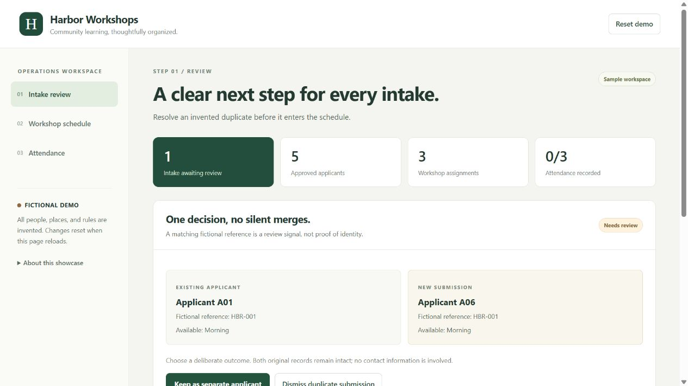
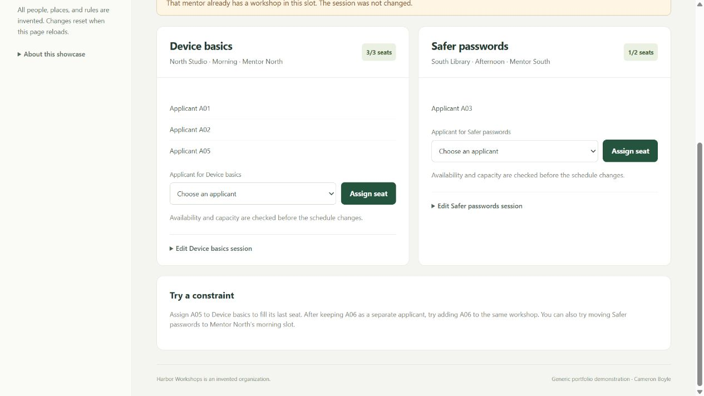

# Harbor Workshops

A fictional operations workspace for reviewing intake, scheduling workshops, and recording attendance. Built as a separate AI-assisted portfolio reconstruction informed by Cameron Boyle's operations-product experience.

[Try the demo](https://cameronjohnboyle2-hub.github.io/harbor-workshops-showcase/) · [Product case study](docs/CASE_STUDY.md) · [Architecture and boundaries](docs/ARCHITECTURE.md) · [Verification](STATUS.md)



## Problem and intended users

Small workshop teams need a clear path from intake to a valid schedule and consistent attendance totals. Coordinators should see why an action is rejected and keep the previous valid state. This invented workspace demonstrates those decisions with six fictional applicants and two workshops.

## Three-minute walkthrough

1. In **Intake review**, keep Applicant A06 separate or dismiss the duplicate flag. The app never silently merges identities.
2. In **Workshop schedule**, assign A05 to the last Device basics seat, then try another approved applicant. Capacity, applicant availability, and mentor conflicts are checked before any update is accepted.
3. In **Attendance**, mark applicants present or absent and filter workshops. Missing records remain unrecorded; totals use the same assignments as the table.
4. **Reset demo** or reload restores the invented examples.



## Run locally

No dependency installation or framework build is required. With Node.js 22 or 24:

```sh
node --test tests/core.test.mjs
node --check app.js
```

Serve the root directory with any static HTTP server. For example, with Python 3 installed:

```sh
python -m http.server 4183 --bind 127.0.0.1
```

Open http://127.0.0.1:4183/. The deployed artifact contains only `index.html`, `main.css`, `app.js`, and `core.mjs`.

## Privacy and security boundaries

All identities, organizations, places, slots, capacities, and rules are invented. State stays in memory and disappears on reload. The source includes no database client, accounts, contact fields, uploads, analytics, external assets, messages, exports, credentials, or production configuration. Its content policy specifies `connect-src 'none'` and denies form submission.

The original GALS portal, protected research, production integrations, records, and Git history remain separate and private. This is a new generic demonstration, not a sanitized copy or replica. Its tests do not establish security or research validity of the original system.

## Contribution and evidence

Cameron provided operations context, product direction, and publication/privacy constraints. Codex prepared the new generic scope, invented fixtures and rules, implementation, and checks. This is AI-assisted work, not solely hand-written source.

Nine domain tests cover explicit duplicate disposition, capacity, availability, mentor conflicts, state preservation on rejection, attendance totals, invalid input, and reset isolation. Local browser review covered the three workflows and a phone-sized viewport. See `STATUS.md` for dated verification and limitations. No actual adoption, time savings, physical-device acceptance, or production reliability is claimed.

## Rights and next steps

No third-party source or bundled media is included; the UI uses system fonts. No general source-reuse license has been granted. Public availability is for portfolio review; obtain permission before reuse. Original protected work has its own rights and is not included.

Lessons: make identity decisions explicit, validate an entire schedule before mutating state, and distinguish missing attendance from absence. Future work includes a field-reviewed Khmer interface, accessibility/user testing, and a separate rights-cleared operational case study with verified outcomes. Production authentication and integrations would require their own implementation and review.
