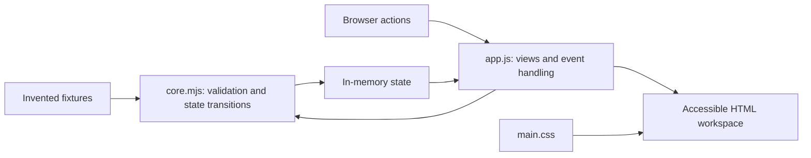

# Architecture and security boundary

Four runtime files, no dependencies or backend.

`index.html` loads only local styles and a local module. `app.js` translates explicit UI actions into domain calls and renders the result. `core.mjs` owns invented fixtures, assignment/schedule validation, intake disposition, attendance, and reset behavior. Rejected changes retain the prior state. `main.css` controls responsive layout and focus states.

There is no persistence, auth, production API, participant/contact information, original research rule, or production database schema. The content policy denies connection APIs, objects, base URL replacement, and form submission. It is a defense in addition to the absence of integrations; it is not evidence that the original portal is secure. A full browser network trace has not been collected.

GitHub Actions runs built-in Node tests and syntax checks, copies only the four runtime files to a Pages artifact, and uses a separate Pages deployment job. Tests and documentation are not hosted in that artifact. Source and screenshots remain reviewable in this fresh repository.
